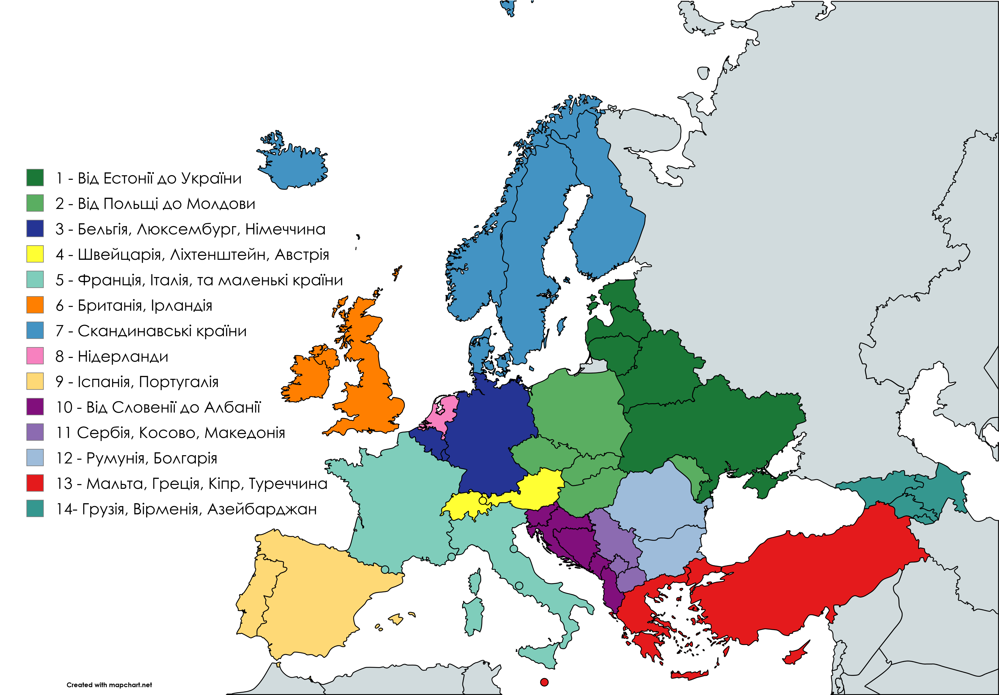

# europe-countries-anki

# Країни Європи — столиці, прапори, мапа й правильна вимова!

Мапа та список до навчальної колоди Anki «Країни Європи».

## Порядок вивчення країн

Щоб було легше вчити, я разташував всі країни у колоді у спеціальній послідовності. На карті, для наочності, Ви можете бачити їх загальний порядок. Знизу є увесь список. Блоки країн об'єднані по регіону і по їх розташуванню: зверху вниз, зліва направо.

Рекомендую на початку приховати усі картки типу Столиця-Країна, щоб вони не заважали вам на старті. Для цього відкрийте зліва файл з такою назвою)

## Пояснення
1. Перший блок країн іде від Естонії до України — з півночі на південь.
2. Другий блок — від Польщі до Молдови.
3. Далі, зліва направо:
   - Бельгія, Люксембург, Німеччина — щоб краще запам'ятати розташування маленького Люксембургу через його сусідів.
   - Швейцарія, Ліхтенштейн, Австрія — щоб краще запам'ятати розташування маленького Ліхтенштейну через його сусідів.
4. Далі, поки вивчаєте Францію та Італію, одразу вивчайте останні 4 маленькі країни на їхній території.
5. Далі такий самий принцип
6. Коли ви починаєте вчити колишні колоніальні країни, за ними підуть їх сучасні території, острови. Ви дізнаєтесь, що до Королівства Данія входить ще 2 території, до Королівства Нідерландів входять ще 3 країни у Карибському морі та багато інших цікавинок)
7. Що до Британії та Франції: у цій колоді є тільки британські території, що знаходяться в Європі та 5 заморських регіонів Франції.

Я у вас є пропозиції або ви хочете вчити в іншій послідосності я можну розповісти як це зробити особисто. Для цього пишіть мені у тг: @nestorlll
## Повний список країн і територій

1.	Естонія
2.	Латвія
3.	Литва
4.	Білорусь
5.	Україна
6.	Польща
7.	Чехія
8.	Словаччина
9.	Угорщина
10.	Молдова
11.	Бельгія
12.	Люксембург
13.	Німеччина
14.	Швейцарія
15.	Ліхтенште́йн
16.	Австрія
17.	Італія
18.	Сардінія
19.	Сіцилія
20.	Ватикан
21.	Сан-Мари́но
22.	Мона́ко
23.	Андо́рра
24.	Франція
25.	Корсика
26.	Гваделу́па
27.	Мартини́ка
28.	Французька Гвіа́на
29.	Реюньйо́н
30.	Майо́тта
31.	Сполучене Королівство
32.	Англія
33.	Шотландія
34.	Уельс
35.	Північна Ірландія
36.	О́стрів Мен
37.	Ге́рнсі
38.	Дже́рсі
39.	Гібралта́р
40.	Акроти́рі і Деке́лія
41.	Ірландія
42.	Норвегія
43.	Шпіцбе́рген і Ян-Має́н
44.	Швеція
45.	Фінляндія
46.	Ала́ндські острови́
47.	Данія
48.	Фаре́рські острови́
49.	Гренландія
50.	Ісландія
51.	Нідерланди
52.	Королівство Нідерландів
53.	Ару́ба
54.	Кюраса́о
55.	Сінт-Ма́ртен
56.	Іспанія
57.	Балеа́рські острови́
58.	Кана́рські острови́
59.	Сеу́та
60.	Мелі́лья
61.	Португалія
62.	Азо́рські острови́
63.	Маде́йра
64.	Словенія
65.	Хорватія
66.	Бо́снія і Герцегови́на
67.	Чорногорія
68.	Албанія
69.	Сербія
70.	Косово
71.	Північна Македонія
72.	Руму́нія
73.	Болгарія
74.	Ма́льта
75.	Греція
76.	Кіпр
77.	Туреччина
78.	Грузія
79.	Вірменія
80.	Азербайджан
81.	Європейський Союз
82.	Скандина́вський півострів
83.	Пірене́йський півострів
84.	Апенні́нський півострів
85.	Балка́нський півострів
