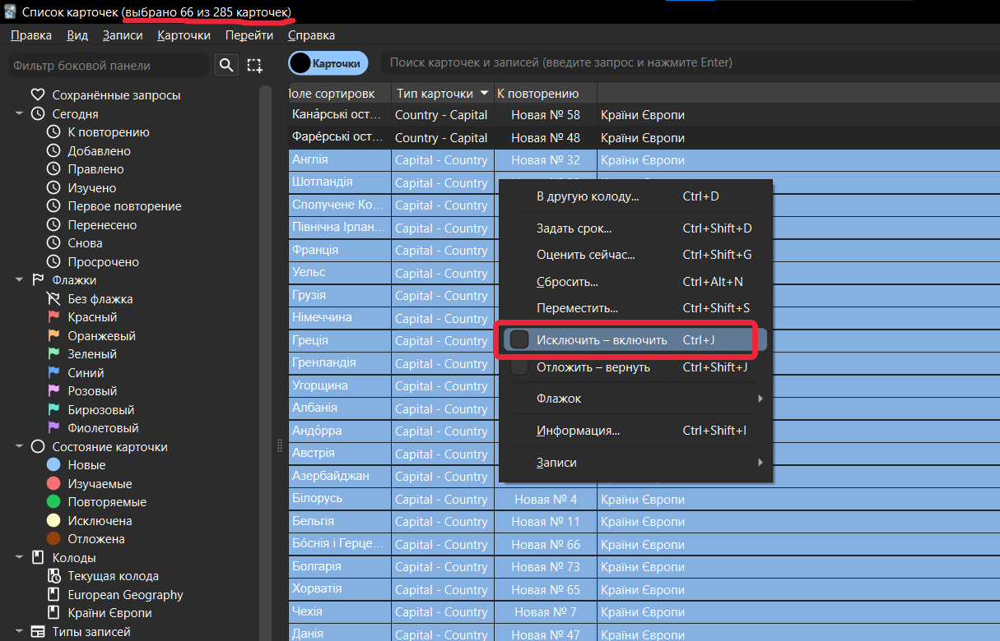

# Як приховати картки типу «Столиця — Країна»

Якщо ви хочете спочатку вивчати лише картки «Країна — Столиця», рекомендую тимчасово приховати картки зворотного напрямку. 

### Крок 1. Відкрийте список записів у колоди

Відкрийте Anki, натисніть на потрібну колоду та натисніть кнопку «Список» або «Browser», розташовану у верхній частині вікна.

### Крок 2. Відкрийти список карток

Натисніть на зелену кнопку (перемикач) між «Записами» та «Картками». Нам потрібні картки (блакитний колір)

### Крок 3. Відсортуйте картки

Натисніть на кнопку сортування «Тип карточки». Гортайте вниз, щоб побачити усі Capital-Country як показано на фото 

### Крок 4. Приховайте картки

Виділіть усі карточки цього типу, натисніть правою кнопкою миші, виберіть «Исключить - Включить»

Все, тепер картки цього виду не будуть з'являтись. Ви можете потім повертати ці карткив в такій самій послідовності. Можете повертати Capital-Country поштучно, а можете усі разом.
