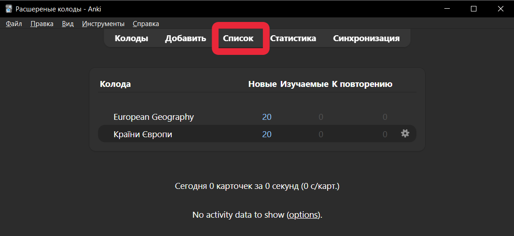
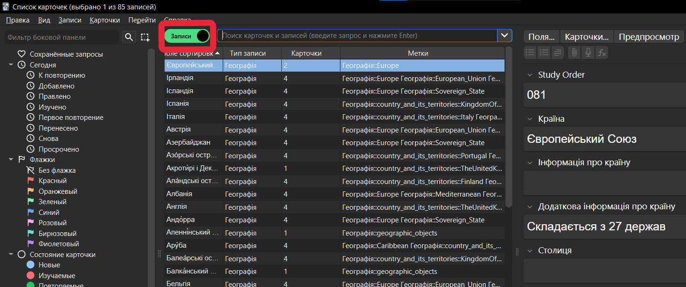
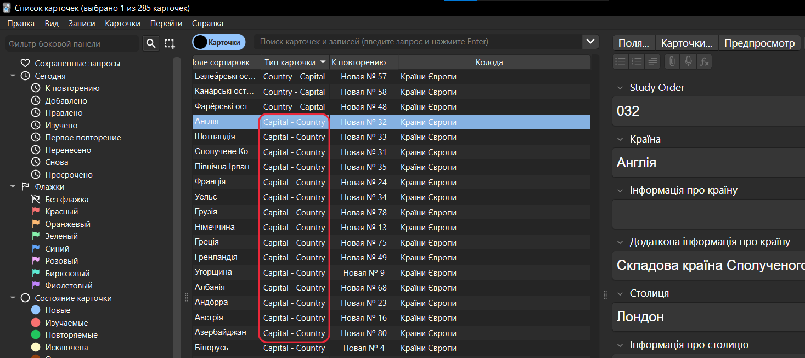

# Як приховати картки типу «Столиця — Країна»

Якщо ви хочете спочатку вивчати лише картки «Країна — Столиця», рекомендую тимчасово приховати картки зворотного напрямку. 

### Крок 1. Відкрийте список карток

Відкрийте Anki, натисніть на потрібну колоду та натисніть кнопку «Список» або «Browser», розташовану у верхній частині вікна.

### Крок 2. Знайдіть потрібні картки

Натисніть на зелену кнопку - перемикач між Записами та Картками. Нам потрібні картки (блакитний колір)

### Крок 3. Виберіть картки

Натисніть на кнопку сортування «Тип карточки». Гортайте вниз, щоб побачити усі Capital-Country як показано на фото 

### Крок 4. Приховайте картки

Виділяйте усі карточки цього типу, натискайте правою кнопкою миші, натискайте «Исключить - Включить»

Все, тепер картки цього виду більше не будуть з'являтися. Ви можете в такій самій послідовності потім повертати ці картки. Можете робити це поштучно, а можете усі разом.
