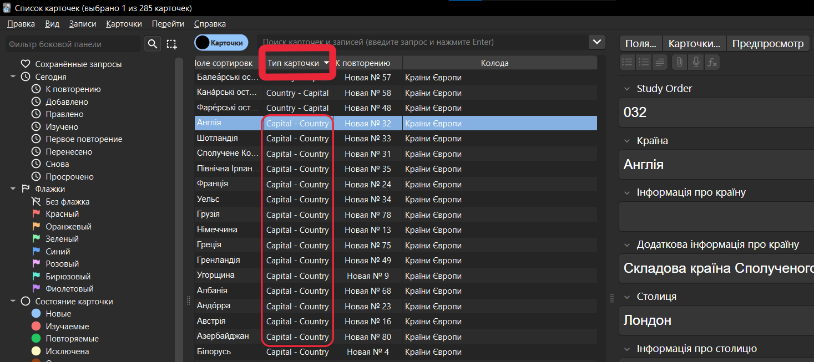

# Як приховати картки типу «Столиця — Країна»

Якщо ви відчуваєте, що картки «Столиця-Країна» вас зараз перегружають — скрийте їх. Я, наприклад, вчив спочатку лише «Країна—Столиця» ну і прапори з мапою.  
**Ось як тимчасово приховати картки зворотного напрямку:** 

### Крок 1. Відкрийте список нотатків у колоди

Відкрийте Anki, натисніть на потрібну колоду та натисніть кнопку «Навігатор» або «Список» або «Browser», розташовану у верхній частині вікна.

### Крок 2. Відкрийти список карток

Натисніть на зелену кнопку (перемикач) між «Нотатки» та «Картки». Нам потрібні картки (блакитний колір)

### Крок 3. Відсортуйте картки

Натисніть на кнопку сортування «Тип картки». Гортайте вниз, щоб побачити усі Capital-Country, як показано на фото 

### Крок 4. Приховайте картки

Виділіть усі карточки цього типу, натисніть правою кнопкою миші, виберіть «Призупинити/Поновити» або «Исключить - Включить»

Все, тепер картки цього виду не будуть з'являтись. Ви можете потім повернути карткив в такій самій послідовності. Можете повертати Capital-Country поштучно, а можете усі разом.
