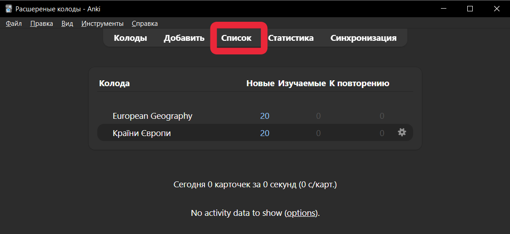
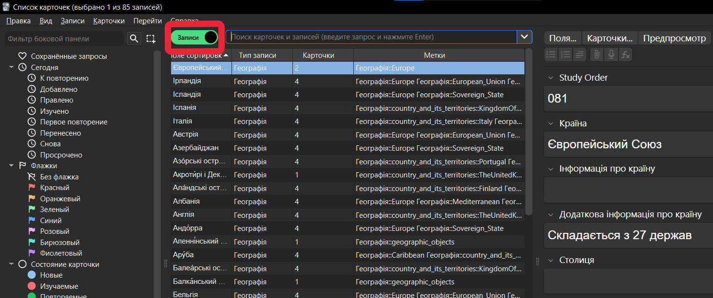
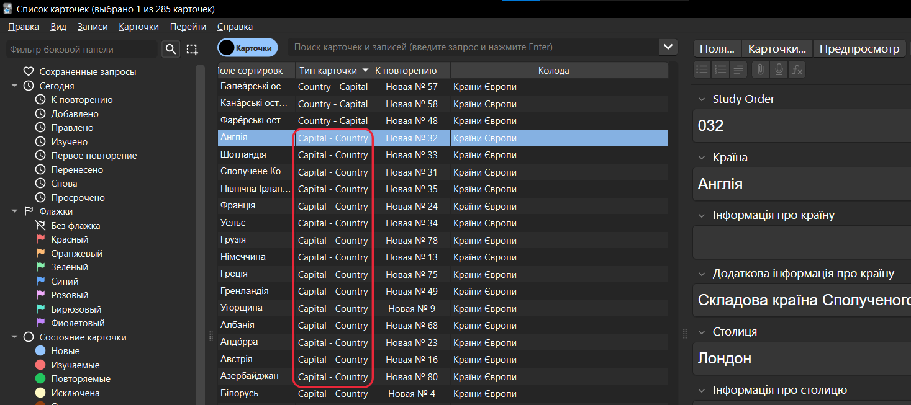
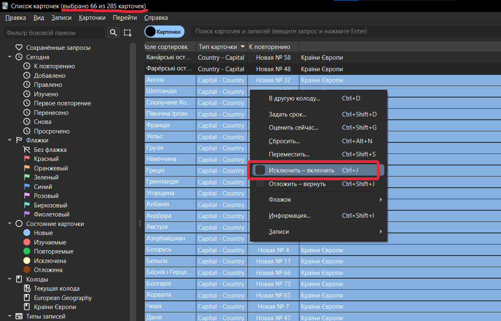

# Як приховати картки типу «Столиця — Країна»

Якщо ви хочете спочатку вивчати лише картки «Країна — Столиця», рекомендую тимчасово приховати картки зворотного напрямку.

### Крок 1. Відкрийте список карток

Відкрийте Anki, виберіть потрібну колоду та натисніть кнопку «Список» (Browser), розташовану у верхній частині вікна.

### Крок 2. Знайдіть потрібні картки

[ТУТ БУДЕ ТВОЄ ПОЯСНЕННЯ]

### Крок 3. Виберіть картки

[ТУТ БУДЕ ТВОЄ ПОЯСНЕННЯ]

### Крок 4. Приховайте картки

[ТУТ БУДЕ ТВОЄ ПОЯСНЕННЯ]

